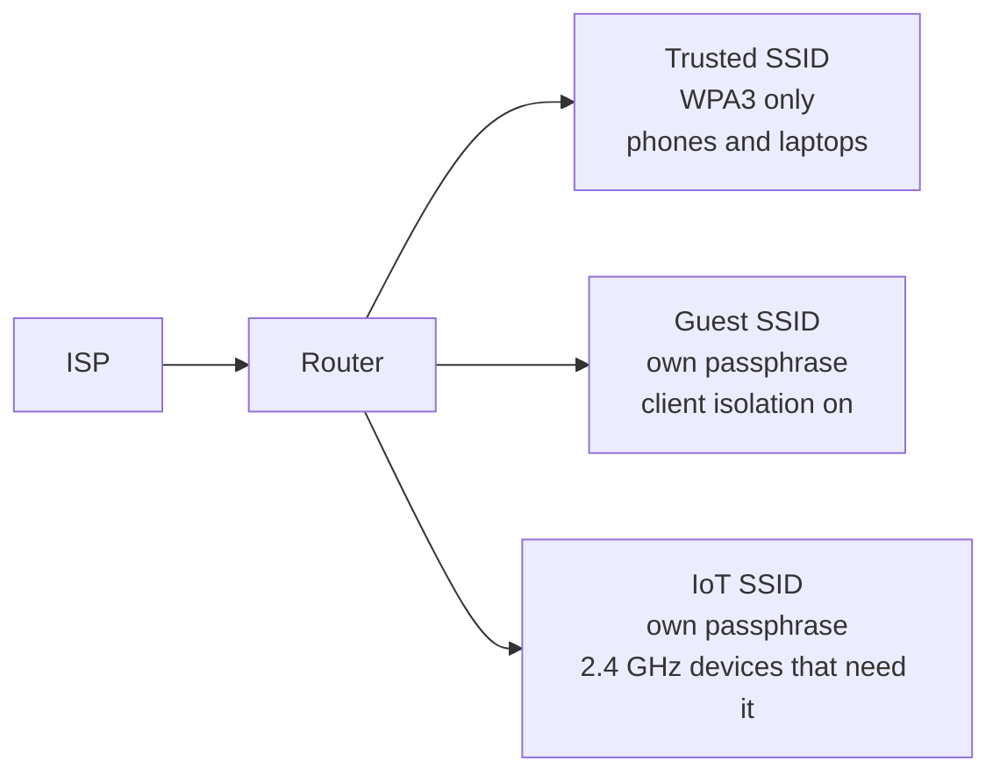

# Hardening guide

Apply this to the spare access point first. Move the household router across when the test client still connects and the guest client cannot see the trusted LAN.

## 1. Prefer WPA3-Personal

WPA3-Personal uses SAE, a password-authenticated key exchange. An overheard join no longer gives someone an offline guess at the passphrase the way a WPA2 handshake does. That is the reason to leave WPA2 behind on any network where every client can connect with WPA3.

Set the trusted SSID to WPA3-Personal only. Set management frame protection to Required. Management frames are how clients are told about the network. Protecting them makes it harder for a third radio to spoof disconnects and steering messages in your name.

Clients that fail to join under WPA3-only belong on the IoT SSID, not on a permanent downgrade of the trusted one.

WPA2/WPA3 mixed mode is a transition setting. It keeps WPA2 available, so the offline-guess problem remains for any client that still uses WPA2, and a careless client can be offered the weaker mode. Use mixed mode only on the IoT SSID, and only while a named device cannot do WPA3. Write that device in the inventory so the exception does not become the default.

Leave these off: WEP, original WPA, TKIP, and any "no security" or open guest mode. An open guest network is convenient and it is also an open network sitting in your house. Give guests a long passphrase and isolation instead.

## 2. Use a strong passphrase, one per SSID

A strong home passphrase is at least four random words from a long word list, or at least 16 characters drawn at random. You should not be able to derive it from your name, address, router model, or a year.

Rules:

- One passphrase for the trusted SSID, a different one for the guest SSID, a different one for IoT, a different one for the lab AP.
- Stored in a password manager, not in this repository and not in a photo of the router sticker.
- The sticker passphrase is changed on day one. Anyone who visited while the box was new has seen it.
- Changed again if a device may have joined a network whose BSSID was not yours, or if the passphrase was emailed or reused on an account.

WPS stays off. A long passphrase does not help while a PIN method is still accepting joins.

## 3. Segment the house

Three SSIDs are enough for a flat or a small house.

| Network | Who joins | Can reach |
| --- | --- | --- |
| Trusted | Your phones and laptops | Each other, printers you choose, the internet |
| Guest | Visitors | The internet only. Not your laptops, not the router admin page. |
| IoT | Bulbs, plugs, TVs, old kit | The internet, and only the trusted devices you explicitly allow |

Client isolation on the guest SSID is the control that stops one guest from opening file shares on another guest's laptop. A separate SSID without isolation is only a different password on the same LAN.

The lab AP stays on its own name and stays off the trusted Ethernet until its review is finished. When you are done with it, power it off.

## 4. Shrink the admin surface

- Admin page reachable only from the trusted LAN, not from the guest SSID and not from the internet.
- Admin password different from every Wi-Fi passphrase.
- Firmware updates turned on, or a repeating calendar reminder if the vendor has no automatic updates.
- UPnP off unless you have named the one device that breaks without it.
- Remote management, cloud accounts on the router, and "allow ping from WAN" left off unless you use them and understand the extra account.

## 5. Re-check

After the changes:

1. Join the trusted SSID with a phone and confirm the phone shows WPA3.
2. Join the guest SSID with a second device and confirm it cannot open the router admin page or a file share on the trusted laptop.
3. Walk the rooms once more and confirm each SSID is announced only by BSSIDs in the inventory.
4. Write the pass and fail rows in the journal without copying the passphrases.

The assessment is finished when the configuration review is all pass, or each remaining fail names the client that forces the exception.
